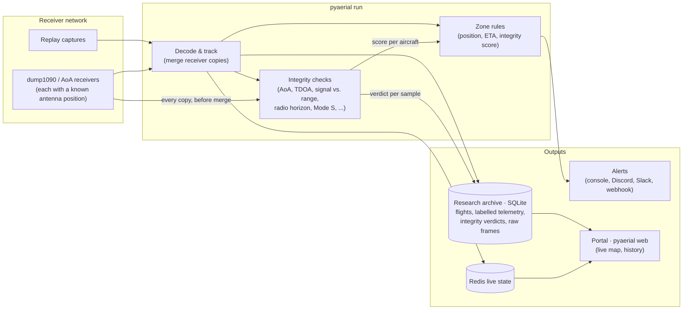

# PyAerial

[](https://python.org)
[](https://www.gnu.org/licenses/gpl-3.0)
[](pyproject.toml)

PyAerial connects a network of ADS-B receivers, checks every aircraft's broadcasts against what the receivers physically measured, and archives the verified data for research. At [AERPAW](https://aerpaw.org) it also alerts on aircraft near the test site.

**How it works**



**Collect**

- Ingests dump1090 TCP feeds (Beast or AVR), angle-of-arrival receivers, and recorded captures from any number of receivers at once. Each receiver's antenna position comes from config or its own `receiver.json`.
- Merges the copies of one transmission heard by several receivers, keeping track of which receivers heard it.
- Decodes position, altitude, velocity, heading, callsign, and category via [`pyModeS`](https://github.com/junzis/pymodes).

**Verify**

- Scores every aircraft from 0 to 1 for spoofing, using angle of arrival, TDOA between receivers (with automatic clock sync and multilateration of the real transmitter), signal strength vs. range, radio horizon, Mode S reply cross-checks, transmit timing, kinematics, replay, and identity. Which checks can run depends on the receivers: AoA needs an antenna array, and TDOA needs two or more receivers with clocks.

**Archive**

- Writes every completed flight to SQLite by default (`archive.flights: all`). Suspected spoofs are labelled, not dropped.
- Labels each telemetry sample with the receivers that heard it and the integrity verdict in effect at the time, and logs every verdict change with its full check results.
- Optionally stores every raw receiver frame (RSSI, 12 MHz clock, AoA), so the evidence behind each verdict stays available for later analysis.

**Alert**

- Evaluates polygon zones (inline, `.kml`, `.kmz`, `.geojson`) against altitude, speed, distance, projected-track ETA, and the integrity score.
- Sends activation, steady-state, and deactivation alerts to the console and to Discord, Slack, or generic JSON webhooks.

**Watch**

- A read-only portal shows the live map, alerts, raw frames, per-aircraft integrity, and archived history. It also re-serves frames as a dump1090 Beast feed for OpenSky and similar networks.
- Caches airframe registration and photos from HexDB and Planespotters in a local `aircraft.db`.

See [CONFIGURATION.md](CONFIGURATION.md) for the archive tables and example research queries.

**Docker deployment**

```bash
cp .env.example .env    # then set REDIS_PASSWORD, e.g. `openssl rand -hex 32`
docker compose up --build
```

Compose refuses to start without `REDIS_PASSWORD`; there is no default. Keep `.env` out of version control (it is git- and docker-ignored).

The web portal (`10090`) and the dump1090-compatible Beast TCP feed (`30005`, for OpenSky Network and similar feeders) are published on `127.0.0.1` only. To reach them from other machines, change the mapping in `docker-compose.yml` deliberately (e.g. `"127.0.0.1:10090:10090"` to `"10090:10090"`), preferably behind a reverse proxy with TLS and authentication. Redis is never published. The engine and web services share database state on the `pyaerial_data` volume (`/data/pyaerial.db`).

Containers run as an unprivileged user (uid 10001) with all capabilities dropped and `no-new-privileges`. Volumes created by older, root-run images need a one-time `docker compose run --rm --no-deps --user root --cap-add CHOWN pyaerial chown -R 10001:10001 /data`.

The engine connects to dump1090 via `DUMP1090_HOST` (defaulting to a feeder on the Docker host), which can be pointed at the bundled SDR service or an external feeder:

```bash
# Ingest from a USB RTL-SDR via the dump1090 compose service
DUMP1090_HOST=dump1090 docker compose --profile sdr up --build

# Ingest from an existing dump1090 daemon (Beast output, host port 30005)
docker compose up --build
```

The SDR service gets USB access through a device cgroup rule rather than `privileged`. Its user is in `plugdev` (gid 46); if the host's RTL-SDR udev rule assigns the device to another group, set `SDR_GID` in `.env`.

To rotate secrets, change `REDIS_PASSWORD` in `.env` and run `docker compose up -d --force-recreate`; rotate webhook URLs at the provider and update the environment variables your `config.yaml` references.

The portal binds `127.0.0.1` by default in local CLI environments; pass `--host 0.0.0.0` when containerizing or exposing to network interfaces.

**Host deployment**

1. Define `home` coordinates and storage targets in [`config.yaml`](config.yaml).
2. Start a Redis server instance (`redis-server`).
3. Start the ADS-B feeder (e.g. `dump1090 --net --raw`).
4. Launch the tracking engine: `pyaerial run -c config.yaml`
5. Launch the web portal: `pyaerial web -c config.yaml --port 10090`. The portal is strictly read-only and reads state from Redis and SQLite without running tracking pipelines. If static assets are missing, build them via `scripts/build_web.sh`.
6. Navigate to `http://localhost:10090`. The portal header displays discrete indicators when the engine heartbeat is lost, Redis is unreachable, or receiver feeds are quiet.

**Installation**

Requires Python 3.11+ and Node.js 20+. `dump1090` is required for live radio reception.

```bash
pip install -e ".[dev]"
```

For reproducible installs, `requirements.lock` pins every runtime dependency with hashes (`pip install --require-hashes -r requirements.lock && pip install --no-deps .`). Regenerate it with `scripts/lock.sh` (requires [`uv`](https://github.com/astral-sh/uv)) after changing dependencies in `pyproject.toml`.

**Reference documentation**

| Document | Focus |
|----------|-------|
| [CONFIGURATION.md](CONFIGURATION.md) | YAML schema, integrity checks, zone rules, Redis schema, and the research archive tables |
| [CLI.md](CLI.md) | Subcommands, environment variable overrides, and service execution |
| [WEBSOCKET.md](WEBSOCKET.md) | Wire protocol, stream subscriptions, RPC action schemas, and client examples |
| [UNITS.md](UNITS.md) | SI base units, conversion formulas, and sensor timestamp standards |

**Command-line interfaces**

| Command | Process role |
|---------|--------------|
| `pyaerial run` | Engine (ingests receivers, scores integrity, alerts, writes Redis live state and the SQLite archive) |
| `pyaerial web` | Web portal and API server (reads Redis and SQLite; does not track) |
| `pyaerial validate` | Syntax, schema, and filesystem cross-reference verification |
| `pyaerial reset` | Archive purger (`--yes`; clears Redis only when engine is stopped; recreates an archive from an incompatible schema) |

Licensed under GPL-3.0-or-later. See [LICENSE](LICENSE).
