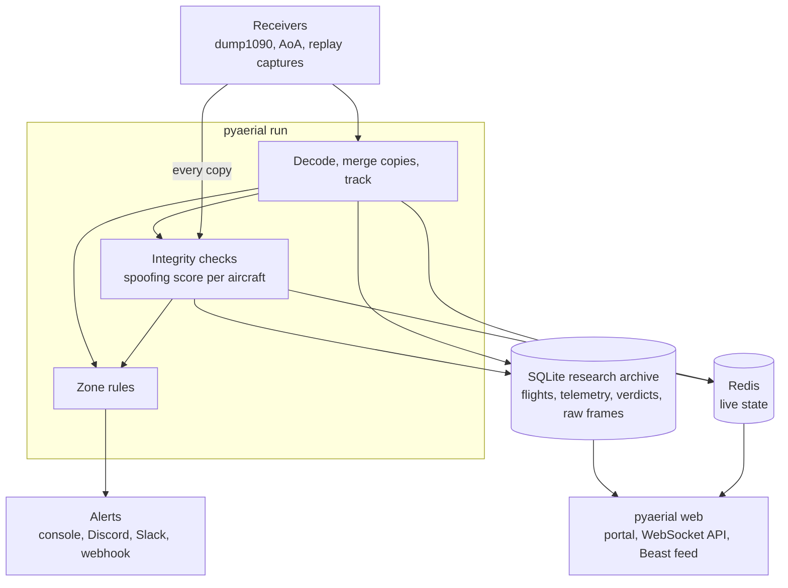

# PyAerial

[](https://python.org)
[](https://www.gnu.org/licenses/gpl-3.0)
[](pyproject.toml)

PyAerial connects a network of ADS-B receivers, checks every aircraft's broadcasts against what the receivers physically measured, and archives the verified data for research. At [AERPAW](https://aerpaw.org) it also alerts on aircraft near the test site.

**How it works**



**Features**

- **Collect**: dump1090 feeds (Beast or AVR), angle-of-arrival receivers, and recorded captures, from any number of receivers. Copies of one transmission are merged, keeping the list of receivers that heard it. Decoding uses [`pyModeS`](https://github.com/junzis/pymodes).
- **Verify**: every aircraft gets a 0-1 spoofing score from up to 16 checks: angle of arrival, TDOA with multilateration of the real transmitter, signal vs. range, radio horizon, Mode S cross-checks, timing, kinematics, replay, identity and more. Which checks run depends on your receivers.
- **Archive**: every completed flight goes to SQLite. Suspected spoofs are labelled, not dropped. Each sample records which receivers heard it and the verdict at the time; raw frames are optional.
- **Alert**: polygon zones (inline, KML, KMZ, GeoJSON) with conditions on altitude, speed, distance, ETA and integrity score. Every activation gets exactly one deactivation, even across engine crashes.
- **Watch**: a read-only portal with live map, alerts, raw frames, per-aircraft integrity and history. It flags a stale engine, unreachable Redis or quiet receivers, and re-serves frames as a Beast feed for OpenSky and similar networks. Registrations and photos come from HexDB and Planespotters.

**Quick start: Docker**

Set `home` and `receivers` in [`config.yaml`](config.yaml) (Compose mounts it read-only), then:

```bash
cp .env.example .env    # set REDIS_PASSWORD, e.g. `openssl rand -hex 32`
docker compose up --build
```

Open `http://localhost:10090`. The engine reads Beast from dump1090 on the Docker host (port 30005). To use a USB RTL-SDR with the bundled dump1090 instead:

```bash
DUMP1090_HOST=dump1090 docker compose --profile sdr up --build
```

[`.env.example`](.env.example) explains the other Compose settings.

**Quick start: host**

Requires Python 3.11+, Redis, and Node.js 22 to build the portal (the Dockerfile and CI pin 22.16). Live reception needs `dump1090`.

```bash
scripts/build_web.sh              # builds the portal into src/pyaerial/static
pip install -e ".[dev]"
redis-server                      # in its own terminal
dump1090 --net                    # Beast output on port 30005
pyaerial run -c config.yaml       # engine
pyaerial web -c config.yaml       # portal on http://localhost:10090
```

No radio? Replay the bundled capture: `pyaerial run -c src/pyaerial/examples/replay.yaml`.

For reproducible installs, `requirements.lock` pins every runtime dependency with hashes: `pip install --require-hashes -r requirements.lock && pip install --no-deps .`. Regenerate it with `scripts/lock.sh` (needs [`uv`](https://github.com/astral-sh/uv)) after changing dependencies in `pyproject.toml`.

**Operations**

*Docker*

- `REDIS_PASSWORD` is required; without it the one-shot `redis-config` service fails and nothing starts. Compose passes it as a secret, never through a container's environment or `docker inspect`. `.env` is git- and docker-ignored; keep it that way. To rotate the password, edit `.env` and run `docker compose up -d --force-recreate`.
- Keep webhook URLs out of `config.yaml`: put each in a file under `./secrets/`, enable the commented `webhook_url` secret in `docker-compose.yml`, and use `url: "${file:/run/secrets/webhook_url}"`. To rotate one, change it at the provider, update the file and recreate the `pyaerial` service.
- The portal (10090) and Beast feed (30105; host side `BEAST_PUBLISH_PORT`) are published on `127.0.0.1` only; Redis is never published. To expose the portal, see the `web` section of [CONFIGURATION.md](CONFIGURATION.md). Prometheus can scrape `http://127.0.0.1:10090/metrics` ([WEBSOCKET.md](WEBSOCKET.md)).
- The engine and portal share `/data/pyaerial.db` on the `pyaerial_data` volume.
- Startup order: `redis-config`, Redis, then the engine (healthy while its heartbeat is fresh and the archive writable) and the portal (healthy while `/ready` answers). On stop, the engine gets 20 s to archive in-flight flights and send final alerts.
- Containers run unprivileged (uid 10001; Redis 999), with all capabilities dropped and `no-new-privileges`. Redis runs read-only without persistence. Logs rotate at 3 x 10 MB; Redis and the portal are capped at 1 GB.
- The bundled dump1090 has its network input ports disabled, so nothing can inject frames. The SDR service gets USB through a device cgroup rule, not `privileged`; set `SDR_GID` if your RTL-SDR udev group is not `plugdev` (46).
- Volumes created by older, root-run images need a one-time `docker compose run --rm --no-deps --user root --cap-add CHOWN pyaerial chown -R 10001:10001 /data`.

*Upgrading*

1. Back up the archive (below), and stop the engine gracefully (`docker compose stop`; it archives in-flight flights).
2. `git pull`, then `docker compose build` (host: `scripts/build_web.sh` and `pip install -e .`).
3. Validate your config, since validation gets stricter between releases: `docker compose run --rm --no-deps pyaerial pyaerial validate -c /opt/PyAerial/config.yaml` (host: `pyaerial validate -c config.yaml`). Read [CHANGELOG.md](CHANGELOG.md) for breaking changes.
4. `docker compose up -d`.

On first start the engine upgrades the archive in place, in one transaction; a failure leaves the file as it was. Until then the portal shows history as unavailable. There is no downgrade: an older PyAerial refuses a newer archive, so going back means restoring your backup.

*Compatibility*

What 1.x promises:

- **Config**: a key is deprecated for at least one minor release, with a `pyaerial validate` warning, before removal. A minor release may reject configs that were already non-functional.
- **Archive**: schema changes within 1.x are additive and bump `PRAGMA user_version`. Upgrade-only.
- **WebSocket API**: `hello.version` (now `1`) increments only when a field or message is removed or changes type. Clients must ignore unknown fields and message types.
- **Webhook**: the JSON body's `schema` (now `pyaerial.alert/1`) changes only on breaking changes; fields are only added.
- **CLI**: subcommands and documented exit codes are stable. Log text is not.
- **Not public**: Redis keys (shared only by `run` and `web` of the same version; upgrade both together) and the `pyaerial` Python package.

*Backups*

The archive is a WAL-mode SQLite file, so `cp` during a run can copy an inconsistent file. Use SQLite's backup API (the image has `python3` but no `sqlite3` CLI):

```bash
docker compose exec pyaerial python3 -c "import sqlite3; src = sqlite3.connect('/data/pyaerial.db'); dst = sqlite3.connect('/data/pyaerial-backup.db'); src.backup(dst); dst.close(); src.close()"
docker compose cp pyaerial:/data/pyaerial-backup.db ./pyaerial-backup.db
```

On a host install, run the same Python against your `database.path`, or `VACUUM INTO 'backup.db'`. To restore, stop the engine and portal, replace the file, and delete any `-wal` / `-shm` files beside it. Also keep `config.yaml`, `.env` and `./secrets/`. `aircraft.db` is a cache that refills itself, and Redis holds only live state.

**Documentation**

| Document | Contents |
|----------|----------|
| [CONFIGURATION.md](CONFIGURATION.md) | Config reference, units, integrity checks, zone rules, alerts and the webhook body, Redis keys, archive tables |
| [CLI.md](CLI.md) | Commands, options, exit codes, environment variables |
| [WEBSOCKET.md](WEBSOCKET.md) | Endpoints, limits, live streams, RPC actions, Beast feed |
| [ARCHITECTURE.md](ARCHITECTURE.md) | Internals for contributors: pipeline, layers, threads, recovery, tests |
| [CHANGELOG.md](CHANGELOG.md) | Release and upgrade notes |

Licensed under GPL-3.0-or-later. See [LICENSE](LICENSE).
