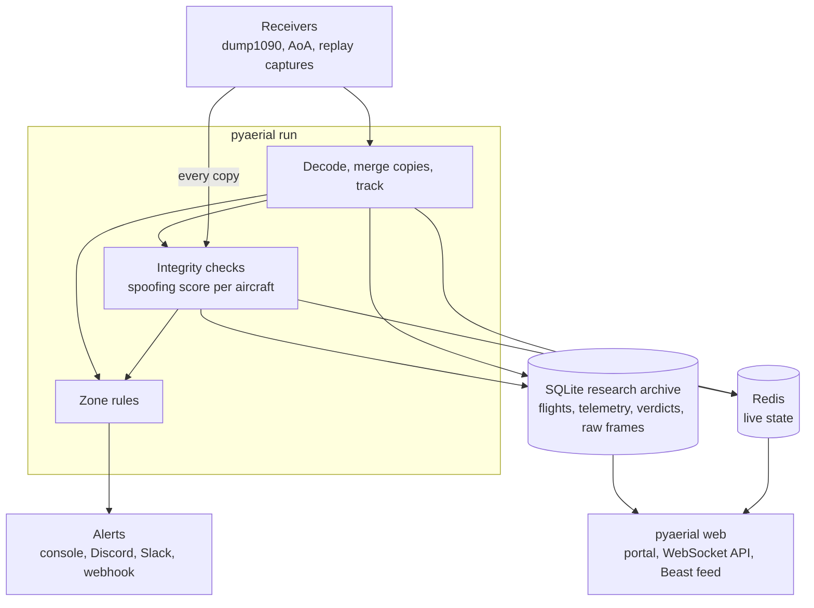

# PyAerial

[](https://python.org)
[](https://www.gnu.org/licenses/gpl-3.0)
[](pyproject.toml)

PyAerial connects a network of ADS-B receivers, checks every aircraft's broadcasts against what the receivers physically measured, and archives the verified data for research. At [AERPAW](https://aerpaw.org), it also alerts operators when aircraft approach the test site.

## How it works



## Features

- Ingests feeds from any number of dump1090 or readsb receivers (supporting Beast and AVR formats), angle-of-arrival arrays, and recorded captures. When multiple receivers capture the same transmission, PyAerial merges the duplicates into a single track update while recording every receiver that heard the signal. All message decoding runs through [`pyModeS`](https://github.com/junzis/pymodes).
- Continuously calculates a 0 to 1 spoofing score for each aircraft using up to 16 physical and protocol checks. Depending on connected receiver capabilities, checks evaluate angle of arrival, time difference of arrival (TDOA) with multilateration of the actual transmitter, signal strength versus range curves, line-of-sight radio horizons, Mode S reply cross-checks, timing jitter, kinematics, frame replay, and ICAO identity verification.
- Saves every completed flight to a local SQLite database for historical analysis. Rather than discarding suspicious flights, PyAerial tags them so you can filter verified data later. Each recorded point logs which receivers heard the aircraft alongside the active integrity score at that moment, with optional raw frame archival.
- Monitors customizable polygon geofences defined directly in the configuration or imported from KML, KMZ, or GeoJSON files. Rules trigger based on altitude, speed, boundary distance, projected arrival time, and integrity score. Alert lifecycles guarantee one deactivation event per activation even across unexpected engine restarts, with details documented under Alerters in [CONFIGURATION.md](CONFIGURATION.md).
- Provides a standalone web portal with a live tracking map, active alerts, raw frame viewer, per-aircraft integrity breakdowns, and full historical search. The portal highlights if the tracking engine stalls, if Redis disconnects, or if receivers go quiet, and it re-broadcasts incoming frames as an aggregated Beast feed for networks like OpenSky. Airframe details and photos are pulled automatically from HexDB and Planespotters.

## Quick start with Docker

Configure your station coordinates under `home` and specify your `receivers` in [`config.yaml`](config.yaml), which Docker Compose mounts read-only into the container:

```bash
cp .env.example .env    # generate a secure REDIS_PASSWORD, such as with `openssl rand -hex 32`
docker compose up --build
```

Then open `http://localhost:10090` in your browser. By default, the engine connects to a Beast stream from dump1090 running on the host system at port 30005. If you want to plug in a USB RTL-SDR dongle and run the bundled dump1090 service directly inside Docker, start Compose with the SDR profile:

```bash
DUMP1090_HOST=dump1090 docker compose --profile sdr up --build
```

Additional Compose environment variables are detailed in [`.env.example`](.env.example).

## Quick start on the host

Running directly on your host machine requires Python 3.11+, a running Redis instance, and Node.js 22 to compile frontend assets (the project Dockerfile and CI pin Node 22.16). Live aircraft reception requires `dump1090`.

```bash
scripts/build_web.sh              # compiles the web portal into src/pyaerial/static
pip install -e ".[dev]"
redis-server                      # launch Redis in a dedicated terminal
dump1090 --net                    # start dump1090 producing Beast frames on port 30005
pyaerial run -c config.yaml       # starts the tracking engine
pyaerial web -c config.yaml       # starts the portal on http://localhost:10090
```

If you do not have an SDR plugged in right now, you can test everything with the bundled sample capture:

```bash
pyaerial run -c src/pyaerial/examples/replay.yaml
```

For reproducible local environments, `requirements.lock` pins every runtime dependency with sha256 hashes. You can install it with `pip install --require-hashes -r requirements.lock && pip install --no-deps .`. Whenever dependencies change in `pyproject.toml`, refresh the lockfile by running `scripts/lock.sh` (which uses [`uv`](https://github.com/astral-sh/uv)).

## Operational notes

### Running in Docker

- The `REDIS_PASSWORD` environment variable must be set in your `.env` file; without it, the initial `redis-config` helper service exits immediately and the stack will not boot. Compose injects this password as a secret rather than exposing it through container environment variables or `docker inspect`. Keep `.env` out of version control and Docker builds. If you need to rotate the password later, update `.env` and recreate the containers with `docker compose up -d --force-recreate`.
- Store sensitive webhook endpoints outside `config.yaml`. Place individual endpoints in files under `./secrets/`, uncomment the `webhook_url` secret declaration in `docker-compose.yml`, and reference the secret using `url: "${file:/run/secrets/webhook_url}"`. When rotating a URL, update the file and restart the `pyaerial` service.
- The web portal on port 10090 and the Beast feed on port 30105 (configured on the host via `BEAST_PUBLISH_PORT`) bind strictly to `127.0.0.1`. Redis never exposes a host port. If you want to expose the portal to a wider network, review the `web` configuration guide in [CONFIGURATION.md](CONFIGURATION.md). Prometheus collectors can scrape metrics directly from `http://127.0.0.1:10090/metrics` as outlined in [WEBSOCKET.md](WEBSOCKET.md).
- Both the engine and the portal access `/data/pyaerial.db` through the shared `pyaerial_data` volume.
- Services start in sequence: `redis-config` renders the Redis configuration, Redis starts, and then both the engine and the portal launch. The engine reports healthy as long as its heartbeat updates regularly and the database remains writable, while the portal is healthy once `/ready` returns a successful response. When shutting down, Docker gives the engine a 20-second grace window to flush current flight tracks and emit final alert deactivations.
- All containers drop extra Linux capabilities and run as unprivileged users (uid 10001 for application processes, uid 999 for Redis) with `no-new-privileges` enabled. Redis operates in read-only mode without disk persistence. Container logs rotate across three 10 MB files, and memory caps limit Redis and the portal to 1 GB each.
- The bundled dump1090 container disables all network input sockets so external traffic cannot inject spoofed frames into the decoder. When running the SDR profile, USB hardware is mapped via device cgroup rules rather than running the container in privileged mode. Set `SDR_GID` if your system's RTL-SDR udev group differs from `plugdev` (gid 46).
- If you have an existing volume created by older PyAerial releases that ran as root, fix its volume permissions once by running `docker compose run --rm --no-deps --user root --cap-add CHOWN pyaerial chown -R 10001:10001 /data`.

### Upgrading

1. Create a clean backup of your SQLite archive using the procedure below, and stop the engine cleanly with `docker compose stop` so it can finish archiving active flights.
2. Pull the latest code with `git pull`, then rebuild your containers with `docker compose build` (or on a host installation, run `scripts/build_web.sh` and `pip install -e .`).
3. Check your configuration against the new release, since validation rules tighten over time. Run `docker compose run --rm --no-deps pyaerial pyaerial validate -c /opt/PyAerial/config.yaml` (or on the host, run `pyaerial validate -c config.yaml`). Check [CHANGELOG.md](CHANGELOG.md) for breaking changes and newly deprecated options.
4. Restart your stack with `docker compose up -d`.

When the new engine boots for the first time, it automatically upgrades the SQLite schema in a single transaction. If the migration fails, the file remains completely untouched. While an upgrade is pending, the portal temporarily indicates that historical records are unavailable. Database migrations only roll forward; older PyAerial releases will reject an archive created by a newer version, so reverting to a previous release requires restoring your database backup.

### Compatibility in 1.x

Across the 1.x release series, we adhere to the following stability guidelines:

- Configuration settings will remain deprecated for at least one minor release, logging validation warnings during `pyaerial validate`, before they are removed. Minor updates may, however, start rejecting configuration settings that were already invalid or non-functional.
- Database changes within 1.x are strictly additive and bump `PRAGMA user_version`. Upgrades happen automatically on startup, but downgrades are not supported.
- The WebSocket API version (`hello.version`, currently `1`) only increments when existing fields are removed or their data types change. Connecting clients should ignore any unfamiliar fields or message types they encounter.
- The webhook JSON payload sticks to schema identifier `pyaerial.alert/1`. Breaking changes will bump the schema version, while routine releases will only add new fields.
- Subcommand names and documented exit codes in the CLI remain stable, although internal log wording may change between releases.
- Internal Redis key structures and Python package internals are not public APIs. Because the engine (`pyaerial run`) and web portal (`pyaerial web`) communicate via shared Redis state, always run identical versions of both services.

### Database backups

Because the research archive uses SQLite in WAL mode, copying the file with a normal `cp` while the engine is running can produce an inconsistent database. Always use SQLite's online backup API instead. The container includes Python for this purpose:

```bash
docker compose exec pyaerial python3 -c "import sqlite3; src = sqlite3.connect('/data/pyaerial.db'); dst = sqlite3.connect('/data/pyaerial-backup.db'); src.backup(dst); dst.close(); src.close()"
docker compose cp pyaerial:/data/pyaerial-backup.db ./pyaerial-backup.db
```

On a host installation, run the same Python command pointing to your `database.path`, or execute `VACUUM INTO 'backup.db'`. When restoring a backup, stop both the engine and portal, copy the backup over the existing database file, and remove any lingering `-wal` or `-shm` sidecar files in the directory. Be sure to back up `config.yaml`, `.env`, and your `./secrets/` directory as well. You do not need to back up `aircraft.db`, since it acts as a self-populating metadata cache, or Redis, which holds only temporary live state.

## Documentation

| Guide                                | Description                                                                                                                                          |
| ------------------------------------ | ---------------------------------------------------------------------------------------------------------------------------------------------------- |
| [CONFIGURATION.md](CONFIGURATION.md) | Complete configuration reference, unit conversions, integrity check descriptions, zone rules, webhook schemas, Redis keys, and archive table schemas |
| [CLI.md](CLI.md)                     | Command-line options, process exit codes, and environment variable overrides                                                                         |
| [WEBSOCKET.md](WEBSOCKET.md)         | WebSocket streams, live RPC actions, connection limits, and the Beast TCP feed                                                                       |
| [ARCHITECTURE.md](ARCHITECTURE.md)   | Internal pipeline design, component layers, threading model, crash recovery, and developer workflows                                                 |
| [CHANGELOG.md](CHANGELOG.md)         | Version history, upgrade notes, and breaking changes                                                                                                 |

PyAerial is released under the GNU General Public License v3.0 or later. Full details are available in [LICENSE](LICENSE).
